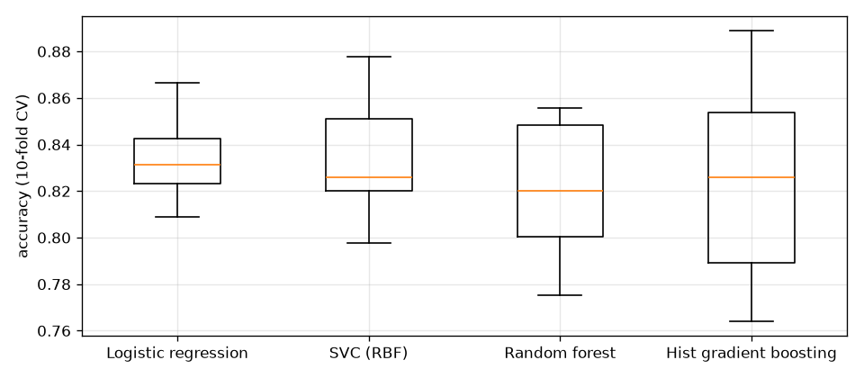

# Titanic survival classifier

**Book:** Chapter 3, Exercise 3 · **Notebook:** [`titanic.ipynb`](titanic.ipynb)

Predict whether a Titanic passenger survived from class, sex, age, family aboard, fare and port of embarkation.

## Approach
1. Explore survival rates by sex, class, port and age: sex and class dominate.
2. Engineer features in a reusable transformer: **Title** from the name (Mr/Mrs/Miss/Master/Rare),
   **FamilySize**, **IsAlone**, **CabinKnown**.
3. `ColumnTransformer`: median-impute + scale numbers, impute + one-hot encode categories.
4. Compare logistic regression, RBF SVC, random forest and histogram gradient boosting with 10-fold
   stratified CV, then grid-search the SVC and the forest.



## Results (10-fold CV accuracy on the 891 labeled passengers)

| Model | CV accuracy |
|---|---|
| **Tuned SVC** (C=3, gamma=0.03) | **0.837** |
| Tuned random forest (max_depth=8, min_samples_leaf=5) | 0.835 |
| Logistic regression | 0.834 |
| SVC (defaults) | 0.833 |
| Histogram gradient boosting | 0.824 |
| Random forest (defaults) | 0.822 |

`test.csv` has no labels (it's Kaggle's submission set), so CV is the performance estimate. The notebook
writes a Kaggle-format submission to `submissions/` (git-ignored).

## Lessons
- Feature engineering (especially `Title`) and clean preprocessing matter more than the model family.
- On 891 rows, the fold-to-fold spread (±2–4 points) is as large as the gap between models.

## Run
```bash
uv sync
uv run jupyter lab ex03-titanic/titanic.ipynb
```
