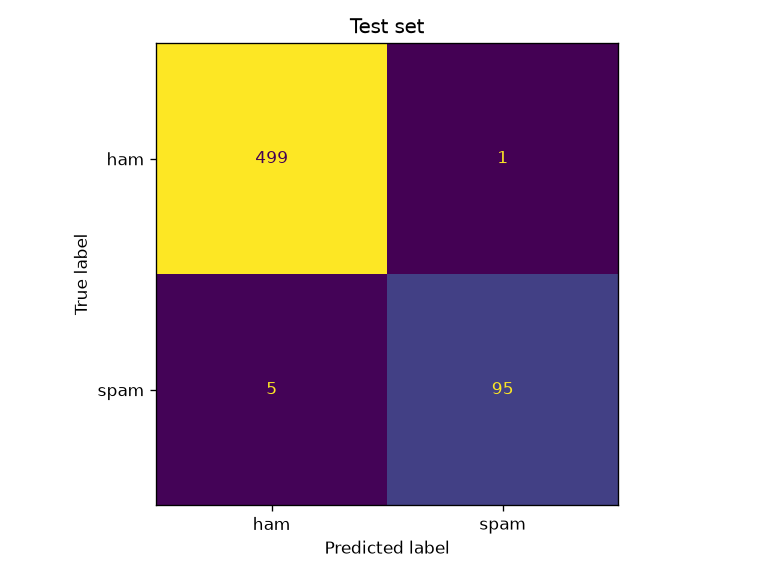

# Spam filter

**Book:** Chapter 3, Exercise 4 · **Notebook:** [`spam_filter.ipynb`](spam_filter.ipynb)

A bag-of-words spam classifier trained on the Apache SpamAssassin public corpus (2,500 "easy ham" + 500 spam emails).

## Pipeline
1. **Parse** raw emails with the standard-library `email` package; take the `text/plain` part, or convert
   `text/html` to text (drop `<head>`, links → `HYPERLINK`, strip tags, unescape entities).
2. **`EmailToWordCounter`** (custom transformer): every preprocessing choice is a hyperparameter —
   `strip_headers`, `lower_case`, `replace_urls` (→ `URL`), `replace_numbers` (→ `NUMBER`),
   `remove_punctuation`, `stemming` (NLTK Porter stemmer). URLs are found with a regex, so no network is needed.
3. **`WordCounterToVector`**: keeps the N most frequent training words and outputs a sparse CSR matrix
   (column 0 counts out-of-vocabulary words).
4. **Classifiers** compared with 3-fold CV, then a grid search over the preprocessing options.

## Results

| Model (3-fold CV, training set) | Accuracy | F1 (spam) |
|---|---|---|
| **Logistic regression** | **0.984** | **0.951** |
| Linear SVC | 0.979 | 0.935 |
| Multinomial naive Bayes | 0.951 | 0.866 |

Best preprocessing (grid search on F1): keep the subject/sender line (`strip_headers=False`), other options on, 1,000-word vocabulary.

| **Test set** (600 emails) | Precision | Recall | F1 |
|---|---|---|---|
| Logistic regression | **0.990** | **0.950** | **0.969** |



## Lessons
- The representation does most of the work; preprocessing toggles moved CV F1 only between 0.948 and 0.962.
- Inspect the weights: the strongest "ham" words (*spamassassin*, *taint*, *rssfeed*) are artifacts of the
  mailing lists the corpus came from, so this model would need retraining before use on a real inbox.

## Run
```bash
uv sync
uv run jupyter lab ex04-spam-filter/spam_filter.ipynb
```
